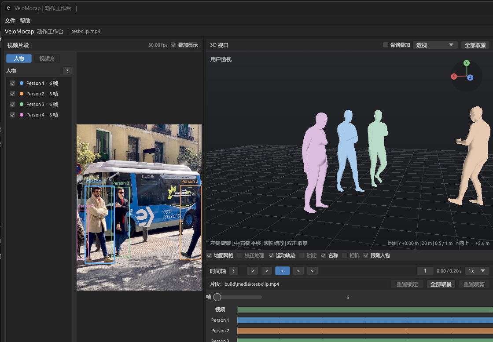

# VeloMocap

**单机位 RGB 视频 → 3D 人体动作，原生 Windows 应用，Rust + C++ 实现。**

导入一段普通视频，得到可直接驱动的动画角色：人物检测与跟踪、3D 人体重建（SAM 3D Body /
MHR）、相机估计、FlowHMR 动作生成、脚部接触清理，最终导出带动画的 `.glb`、BVH 或二进制
FBX。本项目是 [RGB MoCap](https://github.com/toyxyz/toyxyz_RGBMocap) 流程的**重写实现**，
不是它的封装：每个阶段都是本仓库里的代码，运行期不需要 Python。

> English README: [README.md](README.md)



## 基本信息

```yaml
名称: VeloMocap
版本: 0.1.0
平台: Windows x64
运行方式: 原生程序（Rust + C++），运行期无 Python
输入: 单机位 RGB 视频
输出: 带动画的 .glb、BVH、二进制 FBX 7.4
推理: ONNX Runtime (CUDA) + LibTorch TorchScript
界面: egui 桌面程序，中英双语；另有命令行
许可: Apache-2.0（仅源码，模型权重不包含）
```

## 处理流程

```text
视频 ─► YOLOv8 检测 ─► IoU 跟踪
                        │
                        ▼
      SAM 3D Body（LibTorch 跑 TorchScript，ONNX 回退）
      身体 ─► 双手 ─► 融合 ─► MHR 网格
                        │  特征：身体 + 左手 + 右手
                        ▼
      VGGT-Omega 相机 ─► FlowHMR MMDiT ─► SMPL-H 解算 ─► 脚部锁定
                        │
                        ▼
      视口 · 带动画 .glb · BVH · 二进制 FBX
```

## 与 Python 方案（原版及同类项目）相比

| | Python 方案 | VeloMocap |
| --- | --- | --- |
| 运行时 | Python 解释器 + venv，由安装脚本拉运行时 | 单个原生程序，不需要解释器 |
| 每个阶段 | 多个研究仓库用 Python 拼起来 | 检测、跟踪、人体、相机、动作、脚锁、导出，全部在本仓库 |
| 部署 | pip/conda 环境，版本一变就跑不起来 | 一个文件夹：程序 + DLL + 模型路径 |
| 脚本化 | 需要一个 Python 进程 | `velomocap-cli`，一条命令一个任务 |
| 推理 | PyTorch / ONNX | 默认 LibTorch TorchScript，ONNX Runtime 回退，同一份权重 |
| 界面框架 | Qt（PySide6） | egui 即时模式 |
| 导出 | 取决于插件 | 带动画的 `.glb`（网格 + 蒙皮 + 材质 + 动作）、BVH、二进制 FBX |

## 功能

- **导入 → 检测 → 勾选 → 重建**：只跑一遍检测，然后只重建勾选的人；中途跟踪器给人换了
  id，勾选的人还是同一个人，不会变成两个。
- **工程与恢复**：一个 `.vp` 存下视频引用、人物、网格、烘焙好的动作、角色和手工锁定区间；
  工作区还会自动存到 `%TEMP%`，上次没正常退出时下次启动会问你要不要恢复。
- **多人物**：每个人都有独立身份、颜色、网格和动作片段。
- **流式播放**：视频由一个 ffmpeg 进程解码并驱动播放头，画面和动画不会错位。
- **角色**：可导入 VRM、Unreal 或 Mixamo 绑定规范的 glTF/FBX/GLB，动作直接驱动角色，带
  自己的材质贴图；角色库全局共享，导入一次所有工程可用。
- **导出**：角色资产窗口按人生成一个 `.glb`（网格、蒙皮、材质、动作，贴图内嵌）；命令行
  还能写 BVH 和二进制 FBX。
- **脚部锁定**：移植原版的接触校正，并逐帧输出指标（滑步、浮空、下沉、抖动），校正让脚
  更差时整段回滚。
- **自检**：`tools/torch/*_check.py` 把导出的 SAM 模块与 PyTorch 参考实现逐项对齐；各 crate
  的测试覆盖导出器、工程文件以及接触规划的验收指标。

## 从源码构建

需要 Rust（stable）+ MSVC 工具链，Windows x64。

```powershell
cargo build --release -p velomocap-app -p velomocap-cli
```

LibTorch 可选。带上时 SAM 3D Body 走 TorchScript（更快，且包含双手）；不带则走 ONNX。

```powershell
$env:VELOMOCAP_LIBTORCH = "1"
$env:PATH = "<torch>\lib;$env:PATH"
cargo build --release -p velomocap-app -p velomocap-cli
```

## 运行

在放着 `models/` 的目录里运行：

```powershell
velomocap-app.exe                           # 桌面程序
velomocap-app.exe clip.mp4 --detect-only    # 只跑检测，打印候选人物
velomocap-app.exe clip.mp4 --capture        # 无界面直接重建
velomocap-cli flow clip.mp4 --person 1 --bvh out.bvh --fbx out.fbx
```

## 模型不在本仓库

`models/` 与 `runtime/` 被 git 忽略：SAM 3D Body、FlowHMR、VGGT-Omega、YOLOv8，以及
ONNX Runtime / LibTorch / ffmpeg 二进制各有自己的许可，需要单独获取。程序从可执行文件旁边
的 `models/`、`runtime/` 读取；`tools/check_models.py` 会按程序使用的清单校验已装的文件，
各权重的下载地址在[原版仓库](https://github.com/toyxyz/toyxyz_RGBMocap)的模型清单里。
SMPL-H 需要在 [smpl.is.tue.mpg.de](https://smpl.is.tue.mpg.de/) 注册后下载，放到
`models/body_models/smplh/neutral/model.npz`。

`models/` 里多数文件是这里**转换**出来的（ONNX 导出、TorchScript 追踪）。转换件是衍生
作品，不会获得新许可，仍受原权重条款约束：[licenses/README-zh.md](licenses/README-zh.md)
逐文件列出上游、许可证、是否转换、能否再分发，[licenses/](licenses/) 里是必须随转换件
一起分发的许可证全文，并写明哪些上游**不能**再分发（SMPL-H、YOLOv8）；
[licenses/UPLOAD.md](licenses/UPLOAD.md) 是发布到 Hugging Face / 魔搭的操作清单。

## 发布说明

Tag 只标注对应的源码。**不发布任何二进制、压缩包或安装程序**，请按上面的步骤自行构建。

## 范围

只做单机位 RGB。原版还包含多机位采集、实时串流到 Blender、多种模型后端的实时预览，这些
本项目没有实现。MMD 模型可以带材质和 付与（inherit）关系加载，但驱动头发衣物的刚体物理
没有模拟。

## 目录

```text
crates/velomocap-app      egui 工作区、软件视口、中英文、工程与恢复
crates/velomocap-motion   采集、跟踪、FlowHMR 特征、清理、BVH/FBX
crates/velomocap-infer    ONNX 会话、检测器、跟踪器、SAM 链、网格拓扑
crates/velomocap-body     SMPL-H / SMPL-X 解析与蒙皮
crates/velomocap-core     BVH、FBX、接触规划、数学、C++ 内核
crates/velomocap-video    ffmpeg 解码 / 定位 / 流式
crates/velomocap-cpp      LibTorch 桥（C ABI），跑 SAM TorchScript
crates/velomocap-models   模型清单与校验
crates/velomocap-cli      无界面流程
tools/                    离线模型导出、对比、下载
```

## 关键词

动作捕捉 · 无标记动捕 · 视频转动画 · 姿态估计 · 3D 人体 · SAM 3D Body · MHR · SMPL-H ·
SMPL · FlowHMR · VGGT · YOLOv8 · ONNX Runtime · LibTorch · TorchScript · Rust · C++ ·
egui · BVH · FBX · glTF · VRM · 重定向 · Windows

## 许可

Apache License 2.0，见 [LICENSE](LICENSE)。只覆盖本仓库的源码；模型权重、人体模型和第三方
二进制各有自己的许可，见 [NOTICE](NOTICE)。
