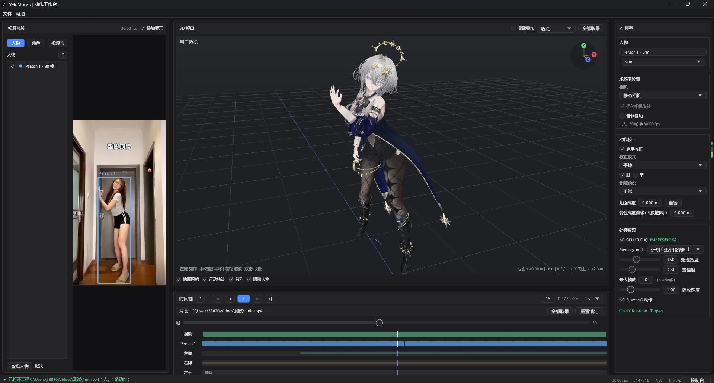
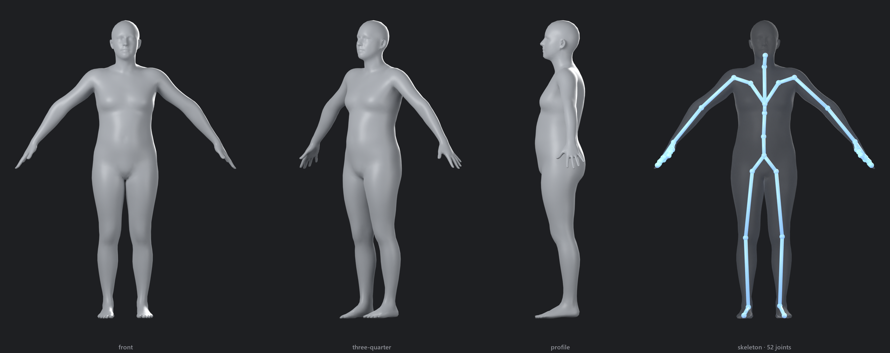

# VeloMocap

**Markerless motion capture from ordinary RGB video, written in Rust and C++ — no Python at runtime.**

VeloMocap turns a phone clip into a rigged, animated 3D human: detect people, reconstruct
their bodies with a 3D body model, estimate camera motion, generate temporally coherent
motion, and export the avatar as one animated **.glb** — mesh, skeleton, materials and take — that drops straight into Blender, Unity or Unreal.



```text
video ─► YOLOv8 detector ─► IoU tracker
                              │
                              ▼
       SAM 3D Body (one TorchScript module through LibTorch, ONNX fallback)
       body pass → both hands → fusion → MHR mesh  18 439 v / 36 874 t
                              │  features: body + left hand + right hand (3072)
                              ▼
       VGGT-Omega camera (ONNX) ─► FlowHMR MMDiT (ONNX) + a Rust sampler
                              │  SMPL-H  6 890 v / 52 joints
                              ▼
       contact cleanup ─► 3D viewport · animated .glb
```

| Stage | Implementation | Measured (RTX 5060 Ti) |
| --- | --- | --- |
| Decode / seek | ffmpeg pipe, any codec | ~60 ms per seek |
| Person detection | YOLOv8x, ONNX Runtime CUDA | 1 ms/frame after warmup |
| Identity tracking | Rust, IoU + coast | 4 people across 90 frames |
| **SAM 3D Body (full)** | **TorchScript via LibTorch** | **0.44 s/person-frame**, parity 1.5e-05 vs PyTorch |
| SAM 3D Body (fallback) | 11 ONNX graphs driven from Rust | 0.26 s/person-frame |
| **FlowHMR motion** | VGGT + MMDiT ONNX, sampler in Rust | 20 Euler steps, 30 fps output |
| Body model | pure Rust SMPL-H / SMPL-X | 6 890 verts, 52 joints |
| Viewport | CPU rasteriser, z-buffer, Gouraud | 147 k triangles ≈ 3 ms |
| **Export** | character asset .glb: mesh, skin, materials, take | 105 368 v / 67 bones in 30.0 MB |

## Why it exists

Most video-to-motion pipelines are a Python stack of PyTorch, OpenCV and a dozen
research repositories. VeloMocap re-implements the whole chain as a normal Windows
application: one folder, no interpreter, no environment variables, deterministic
timings. It is a re-implementation of the **RGB MoCap** pipeline
([toyxyz_RGBMocap](https://github.com/toyxyz/toyxyz_RGBMocap), MIT), not a wrapper
around it.

## Features

* **Native desktop app** (egui/eframe) with the original workspace layout: movie clip,
  3D viewport, timeline, person list, settings sidebar, Chinese and English UI.
* **Import → detect → select → reconstruct**: importing a clip runs one detection pass,
  you tick who to capture, and only those people are reconstructed.
* **Streaming playback**: the video plays through a single ffmpeg process whose frames
  drive the playhead, so picture and animation never drift apart.
* **Multi-person**: every person gets an identity, a colour and its own motion clip.
* **Exports**: the character asset export above is the app's export. The `velomocap-cli` binary
  can also write a bare skeleton as BVH (Character Studio bone names, a uniform
  `Zrotation Xrotation Yrotation` encoding) or binary FBX 7.4 in centimetres.
* **Characters**: import a **VRM** avatar, an **Unreal Engine** body, or any
  **Mixamo-rigged** glTF/FBX/GLB, and the generated clip drives it in the viewport with its own
  materials and textures. `UE5_Manny_Simple`, `UE5_Quinn_Simple` and `Mixamo_Remy` ship in
  `models/characters/`, so a fresh install already has three rigs to export to. The library is
  shared by every project: import once, use everywhere.
* **Character asset export**: one window sized like a DCC export panel — tick mesh/skin,
  materials and animation, give each character its own file name, and browse for the output
  folder. It writes the model that is on screen as a single **.glb**, so Blender, Unity or
  Unreal import a skeletal mesh with its take instead of motion that has to be re-skinned;
  the textures travel inside the file.
* **MMD (experimental)**: PMX models load with their materials, 付与 (inherit) links and
  deform bones; the rigid-body physics that moves MMD hair and cloth is not simulated yet.
* **Self-checking**: SAM parity tests run the PyTorch reference and the exported module
  in one process; an exported `.glb` is checked by importing it into Blender and comparing
  the rebuilt skeleton — rest poses and every animated frame — against the file's own data.

## Install

Two ways to run it:

1. **Portable release** — download the archive, unzip, run `VeloMocap.cmd`. Everything
   (LibTorch, ONNX Runtime, ffmpeg, models) is inside the folder; nothing to install.
2. **From source** — Rust 1.80+ and the Visual C++ toolchain:

```powershell
cargo build --release -p velomocap-app -p velomocap-cli

# optional: run SAM 3D Body through LibTorch (2.4x faster and with hands)
$env:VELOMOCAP_LIBTORCH = "1"
$env:PATH = "<torch>\lib;$env:PATH"
```

Model weights are **not** part of this repository. `tools/fetch_models.py` lists every
file the app looks for, and `models/manifest.json` carries sizes and SHA-256 hashes.
SMPL-H must be downloaded from
[smpl.is.tue.mpg.de](https://smpl.is.tue.mpg.de/) after registration and placed at
`models/body_models/smplh/neutral/model.npz`.

## Use

```powershell
VeloMocap.cmd                               # GUI
VeloMocap.cmd clip.mp4 --capture            # reconstruct everyone, headless
VeloMocap.cmd clip.mp4 --play               # open and play
VeloMocap.cmd clip.mp4 --detect-only        # detection pass only, prints candidates
```



*The body model behind every take — SMPL-H, 6 890 vertices and 52 joints, in a
neutral A-pose from the front, three-quarter and profile, next to its skeleton.*

Command line:

```powershell
velomocap-cli flow clip.mp4 --person 1 --frames 60 --bvh out.bvh --fbx out.fbx
velomocap-cli people clip.mp4 --ply out/          # one mesh per person
velomocap-cli ort                                 # execution provider report
```

## Verified, not claimed

| Check | Result |
| --- | --- |
| SAM 3D Body vs the PyTorch reference (bf16) | verts 1.3e-03 m, kps2d 0.6 px, camera 1.0e-03 |
| SAM 3D Body vs the PyTorch reference (fp32) | verts 1.5e-05 m |
| FlowHMR feature rows | all 3072 columns filled (body + both hands) |
| BVH export | 52 bones, uniform ZXY, Character Studio names |
| FBX export | 52 bones, 159 curves, cm units, re-parsed and compared to the source |
| FBX rotation fidelity | frame 0 exact; worst 0.035 across 12 frames (matrix element) |
| End-to-end | 90 frames × 4 people in 21 min on one GPU |

## Repository layout

```
crates/velomocap-app      egui workspace, software viewport, i18n
crates/velomocap-motion   capture, FlowHMR features, cleanup, BVH/FBX
crates/velomocap-infer    ONNX sessions, detector, tracker, SAM chain, mesh topology
crates/velomocap-body     SMPL-H / SMPL-X parsing and skinning
crates/velomocap-core     BVH, FBX, contact planning, math, C++ kernels
crates/velomocap-video    ffmpeg decode / seek / streaming
crates/velomocap-cpp      LibTorch bridge (C ABI) for the SAM TorchScript module
crates/velomocap-models   model manifest and verification
tools/torch, tools/onnx   offline export scripts for the TorchScript / ONNX models
```

## License

**Apache License 2.0** — see [LICENSE](LICENSE). It covers the code in this repository
only. Model weights, SMPL/SMPL-H and the third-party binaries keep their own licenses;
[NOTICE](NOTICE) lists them and the exclusions.

## Topics

`motion-capture` · `pose-estimation` · `3d-human` · `smpl` · `smplx` · `bvh` · `fbx` ·
`rust` · `cpp` · `onnxruntime` · `libtorch` · `gpu` · `computer-vision` ·
`markerless-mocap` · `egui` · `video-to-animation` · `retargeting`

中文说明见 [README-zh.md](README-zh.md)。
